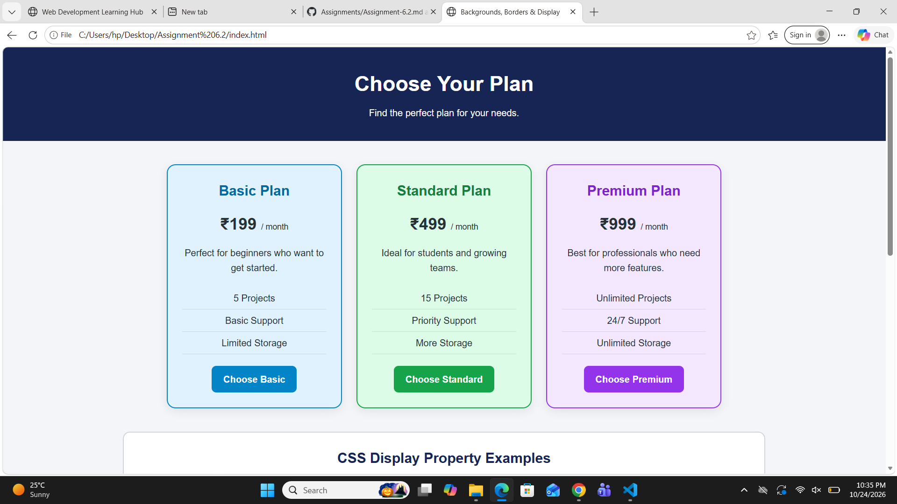

# Assignment 6.2 — Backgrounds, Borders & Display

## Theory

The purpose of this assignment is to understand how CSS backgrounds, borders, display properties, and dimensions are used to design attractive and well-organized web pages.

### 1. Background Colors

The CSS `background-color` property is used to set the background color of an HTML element. Different background colors help distinguish between the three cards: Basic, Standard, and Premium.

### 2. Borders

The CSS `border` property is used to create a visible outline around an element. Different border styles, colors, and thicknesses can be used to make each card look unique.

### 3. Rounded Corners

The `border-radius` property is used to create rounded corners for cards and buttons. It improves the appearance of a webpage by giving elements a smooth and modern design.

### 4. Display Properties

CSS provides different display properties to control how elements appear on a webpage.

- Block: An element starts on a new line and usually occupies the available width.
- Inline: An element stays on the same line and occupies only the space it needs. Width and height generally cannot be set directly.
- Inline-block: An element stays on the same line while allowing width and height to be specified.

These properties help arrange elements according to the requirements of a webpage.

### 5. Width, Height, and Max-Width

- Width: Defines the width of an element.
- Height: Defines the height of an element.
- Max-width: Sets the maximum width an element can have, helping maintain a responsive layout on different screen sizes.

These properties are useful for controlling card sizes and keeping the webpage organized.

## Conclusion

In this assignment, I learned how to use CSS background colors, borders, rounded corners, and display properties to create three differently styled cards. I also learned how to control element dimensions using `width`, `height`, and `max-width`. These CSS properties help create attractive, structured, and user-friendly web pages.
## SCREENSHOTS
